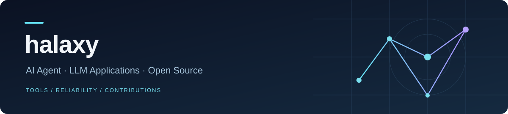
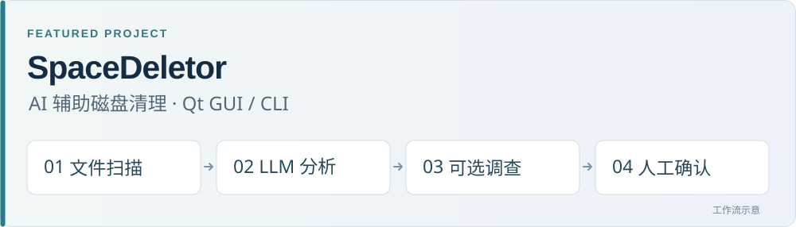

  

  <a href="#重点项目">项目</a> &nbsp; / &nbsp;
  <a href="#开源贡献">贡献</a> &nbsp; / &nbsp;
  <a href="#技术实践">技术</a> &nbsp; / &nbsp;
  <a href="https://github.com/pulls?q=is%3Apr+author%3A89799969+is%3Amerged">全部已合并 PR ↗</a>

我是 **halaxy**，关注 **AI Agent / LLM 应用工程**。我把模型接入本地工具，也通过开源贡献处理 Agent 工具链中的协议、配置与可靠性问题。

> **求职方向** · AI Agent / LLM 应用开发、AI 开发者工具与相关后端工程。

## 重点项目

  

### [SpaceDeletor](https://github.com/89799969/spacedeletor)

**AI 辅助磁盘清理工具** · `Python` `PySide6 / Qt` `Function Calling`

从大文件扫描到清理建议，提供 Qt GUI 与 CLI。对不确定文件调用元数据查询和网页搜索工具，执行清理前由用户确认。

- **模型接入**：可配置的 OpenAI 兼容接口，支持多轮工具调用；对指定模型使用 JSON Schema 约束输出。
- **可靠性**：批处理、并发限速与指数退避；校验返回条目，对缺失结果补提，保留待复核项。

[源码 ↗](https://github.com/89799969/spacedeletor/tree/main/spacedeletor) &nbsp; · &nbsp; [使用说明 ↗](https://github.com/89799969/spacedeletor#readme) &nbsp; · &nbsp; [测试用例 ↗](https://github.com/89799969/spacedeletor/tree/main/tests)

<strong>更多项目</strong> · Web 交互与算法可视化

- **[Memory Game](https://github.com/89799969/memory-game)** — Flask 与原生 JavaScript 记忆翻牌游戏，包含后端状态管理、难度选择和实时计分。
- **[Binary Multiplication](https://github.com/89799969/binary-multiplication-manim)** — 使用 Python / Manim，通过寄存器和移位动画解释二进制乘法过程。

## 开源贡献

参与的开源项目与已合并 PR：

### [ANOLISA / AgentSight](https://github.com/agentic-os-org/ANOLISA) · LLM 可观测性

`Rust`

[已合并 PR #4116 ↗](https://github.com/agentic-os-org/ANOLISA/pull/4116) &nbsp; · &nbsp; [#4249 ↗](https://github.com/agentic-os-org/ANOLISA/pull/4249)

### [nanocoder](https://github.com/Nano-Collective/nanocoder) · Agent 工具链

`TypeScript` `MCP`

[已合并 PR #1256 ↗](https://github.com/Nano-Collective/nanocoder/pull/1256) &nbsp; · &nbsp; [#1255 ↗](https://github.com/Nano-Collective/nanocoder/pull/1255)

<strong>更多开源项目</strong>

- **[Apache RocketMQ Dashboard](https://github.com/apache/rocketmq-dashboard)** · Java · [已合并 PR #4202 ↗](https://github.com/apache/rocketmq-dashboard/pull/4202)
- **[Subtitle Edit](https://github.com/SubtitleEdit/subtitleedit)** · C# · [已合并 PR #11150 ↗](https://github.com/SubtitleEdit/subtitleedit/pull/11150)

## 技术实践

- **LLM / Agent** · 模型接口接入、Function Calling、JSON Schema、MCP 与 SSE 流式事件处理。
- **应用开发** · Python / PySide6 桌面工具、CLI，以及 Flask / JavaScript Web 交互。
- **代码维护与验证** · Rust、TypeScript、Java、C# 开源贡献；通过 pytest、Cargo test、TypeScript 测试和 Maven / JUnit 编写回归覆盖。

   
  <strong>把模型接入真实工具，把问题修到可验证。</strong> 
  <a href="https://github.com/89799969/89799969/issues">交流 AI 应用与开源协作 ↗</a>

